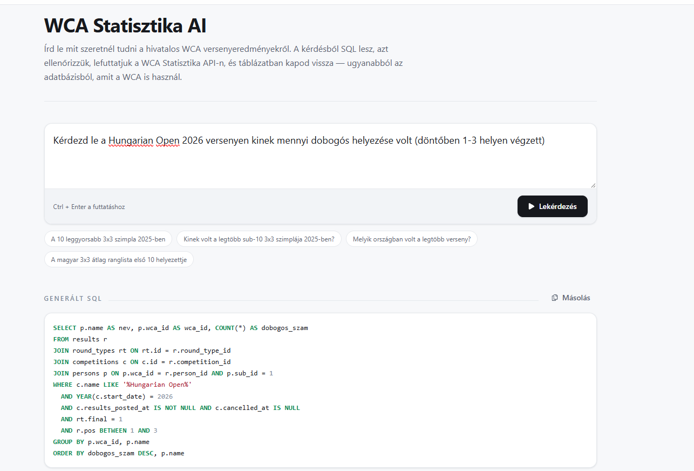

# WCA Statistics AI

Ask questions about official World Cube Association competition results in
plain language — usually Hungarian. The question goes to Groq, which writes SQL
against the WCA Statistics database schema; the SQL is validated server-side,
run through the WCA Statistics API on behalf of a signed-in WCA account, and the
rows come back as a paginated table.

The interface is in Hungarian and uses the Speedcubing Hungary design system, so
the two sites read as one family.



```
browser → /api/query → Groq → SQL validation → WCA OAuth token → WCA Statistics API → table
```

The Groq API key, the WCA client secret and the OAuth tokens are server-side
only. The browser never sends SQL and never receives a credential.

## Getting started

```bash
npm install
cp .env.example .env.local   # then fill it in — see below
npm run dev
```

Open http://localhost:3000, sign in with WCA, and ask a question.

Other scripts:

| Command         | What it does                                       |
| --------------- | -------------------------------------------------- |
| `npm run dev`   | Development server                                  |
| `npm run build` | Production build, including a full type check       |
| `npm start`     | Serve the production build                          |
| `npm run lint`  | ESLint                                              |
| `npm test`      | Regression tests for the SQL validator              |

## Configuration

All values live in `.env.local`, which is git-ignored. `.env.example` documents
every variable.

### Groq

1. Create an API key at https://console.groq.com/keys.
2. Set `GROQ_API_KEY`.

`GROQ_MODEL` is optional and defaults to `openai/gpt-oss-120b`. The app uses
Groq's strict structured outputs, so any replacement model must support
`response_format: { type: "json_schema", strict: true }`. If Hungarian questions
come back poorly understood, this is the first knob to turn.

#### Keeping Groq usage low

Groq's free tier limits tokens per minute and per day, so the app is built to
spend as few as possible:

- **SQL cache** (`lib/sql-cache.ts`): the SQL for a question the WCA API has
  accepted is kept for 24 hours, keyed by the lower-cased question with
  punctuation removed. Asking the same question again (including the example
  chips) costs no Groq call. If a cached query starts failing, it is dropped
  and regenerated.
- **Low reasoning effort**: for `openai/gpt-oss-*` models the request sends
  `reasoning_effort` (`GROQ_REASONING_EFFORT`, default `low`) and
  `include_reasoning: false`. Most of the output tokens of these models are
  hidden reasoning.
- **Output cap**: `max_completion_tokens` defaults to 1024
  (`GROQ_MAX_TOKENS`, 256–4096). Raise it, or the reasoning effort, if long
  queries come back cut off with an invalid-JSON error.
- **Compact prompt**: the system prompt in `lib/wca-schema.ts` is about 1.8k
  tokens. It is sent with every uncached question and again on a correction
  attempt, so keep additions terse.
- When Groq answers `429`, the user sees a "quota exhausted, retry in N
  seconds" message instead of a generic error.

### WCA OAuth

The WCA Statistics API only executes queries for a signed-in WCA user, so the
app runs the OAuth 2.0 authorization code flow against the WCA website.

1. Register an application at
   https://www.worldcubeassociation.org/oauth/applications
2. Set the redirect URI to `http://localhost:3000/api/auth/callback` for local
   development, or `https://your-domain/api/auth/callback` in production.
3. Request the `public` scope — that is all this app needs.
4. Copy the application's ID and secret into `WCA_CLIENT_ID` and
   `WCA_CLIENT_SECRET`, and set `WCA_OAUTH_REDIRECT_URI` to the exact same URI
   you registered.

Endpoints used, per the
[WCA API documentation](https://docs.worldcubeassociation.org/knowledge_base/v0_api.html):

| Purpose      | Request                                                  |
| ------------ | -------------------------------------------------------- |
| Authorize    | `GET https://www.worldcubeassociation.org/oauth/authorize` |
| Token        | `POST https://www.worldcubeassociation.org/oauth/token`    |
| Identity     | `GET https://www.worldcubeassociation.org/api/v0/me`       |

### Session

`SESSION_SECRET` encrypts the cookie that holds the access token. Generate one
with:

```bash
node -e "console.log(require('crypto').randomBytes(32).toString('base64url'))"
```

Changing it signs everyone out.

## How it fits together

| Path                          | Role                                                        |
| ----------------------------- | ----------------------------------------------------------- |
| `app/page.tsx`                | Server-rendered shell; reads the session, renders the console |
| `app/api/query/route.ts`      | The one endpoint: generate, validate, run, paginate          |
| `app/api/auth/*`              | OAuth login, callback and logout                             |
| `lib/wca-schema.ts`           | Database schema and prompt context given to Groq             |
| `lib/groq.ts`                 | Structured-output call to Groq                               |
| `lib/sql-validator.ts`        | The read-only guard; nothing reaches WCA without it          |
| `lib/wca-oauth.ts`            | Authorize URL, code exchange, refresh, `/me`                 |
| `lib/session.ts`              | Encrypted HttpOnly session cookie                            |
| `lib/wca-api.ts`              | `POST /database/query` client                                |
| `lib/query-store.ts`          | Server-side handles so paging costs no Groq call             |
| `lib/sql-cache.ts`            | Question → accepted SQL cache so repeats cost no Groq call   |
| `lib/rate-limit.ts`           | Per-session and per-address limits                           |
| `components/*`                | Input, SQL display, results table, pagination, errors        |
| `components/ui/*`             | Speedcubing Hungary primitives: Button, Card, PageHeader, …  |
| `components/svgs/*`           | The Speedcubing Hungary logo, copied from that project        |
| `app/globals.css`             | The Speedcubing Hungary design tokens                        |

### Design system

`app/globals.css` carries the Speedcubing Hungary tokens verbatim — the same
names and the same values, including the dark theme. `components/ui/` holds the
same primitives that site uses (`Button`, `Card`, `PageHeader`,
`StateMessage`), so anything built here matches without re-deciding a palette.
`components/svgs/SpeedcubingFullAnimatedSVG.tsx` is that project's logo file
copied unchanged, rendered in the navbar with `animated={false}` exactly as it
is there; its keyframes came across into `globals.css` with it.
Geist and Geist Mono load with the `latin-ext` subset, which Hungarian ő and ű
need.

### Language

The UI, the copy and the error messages are Hungarian. The Groq system prompt
states that questions usually arrive in Hungarian and instructs the model to
reply — the `explanation` and `error` fields, and the column aliases — in the
language the question was asked in, so an English question still gets an English
answer.

`HUNGARIAN_GLOSSARY` in `lib/wca-schema.ts` maps the vocabulary that does not
translate literally: event names (*egykezes* → `'333oh'`, *vakon* → `'333bf'`,
*legkevesebb lépés* → `'333fm'`), result terms (*szimpla*, *átlag*, *sub-10*,
*dobogó*), and record codes (*országos rekord* → `'NR'`). Extend it as new
phrasings show up in real use.

Note that the WCA API's own errors — MySQL messages — arrive in English and are
shown as-is.

### Improving query accuracy

`lib/wca-schema.ts` is the file to edit. It holds the table and column list,
the Hungarian glossary, the result-value conventions (hundredths of a second,
`-1` for DNF, the `wca_statistics_time_format` helper), the constraints imposed
by the API's pagination wrapper, and the worked examples. Adding examples there
is the cheapest way to fix a class of bad queries.

`API_CONSTRAINTS` also steers the model away from query shapes that time out.
The WCA API enforces a 120-second limit per query and runs every query twice
(once for the page, once wrapped in `count(*)` for pagination), so a slow query
costs double. The most common trap is a question like "who first competed in
2016" being answered by joining `results` to `competitions` and calling
`YEAR(c.start_date)` — that scans both large tables. `concise_single_results`
and `concise_average_results` already carry `year`/`month`/`day` per row, so
the same question can run as a `GROUP BY person_id` over one table with no
join at all. The prompt now names this pattern explicitly, with a worked
example.

### SQL safety

Only single read-only statements are forwarded. The validator masks string
literals, quoted identifiers and comments, then requires the statement to start
with `SELECT`, `WITH` or `SHOW`, rejects any `;` that separates statements,
rejects the write and administration keywords, rejects MySQL's executable
`/*! */` comments, and fails closed on anything it cannot parse confidently.
`npm test` covers the cases.

The browser cannot supply SQL at all: `POST /api/query` takes either a natural
language `prompt` or a `queryId` that refers to a statement the server already
generated and validated.

### Error handling

Failures are reported with the stage they came from — `groq`, `validation`,
`wca`, `auth`, `rate_limit` or `input`. When the WCA API rejects a generated
query, the error is sent back to Groq for exactly one correction attempt before
the failure is shown to the user.

## Assumptions

- The WCA Statistics API runs MySQL 8 loaded from the WCA developer database
  dump, so column names are snake_case and the schema in `lib/wca-schema.ts`
  follows that dump rather than the older CamelCase results export.
- The API wraps every submitted query as
  `SELECT * FROM ( <query> ) alias LIMIT ? OFFSET ?`, which is why the prompt
  insists on uniquely aliased columns and no trailing semicolon.
- Page size is capped at 100 by the API; the app requests 25 by default.
- The API rejects concurrent queries from the same token, so the UI runs one
  query at a time.
- Rate limiting is in-process. Behind multiple instances the limits apply per
  instance.

---

Results come from the World Cube Association, published at
https://www.worldcubeassociation.org/results. This is an unofficial tool and is
not affiliated with the WCA.
